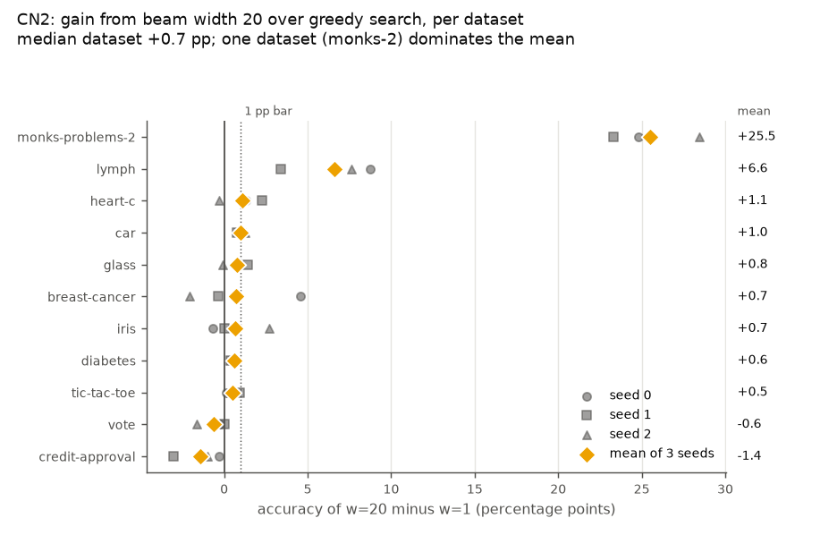
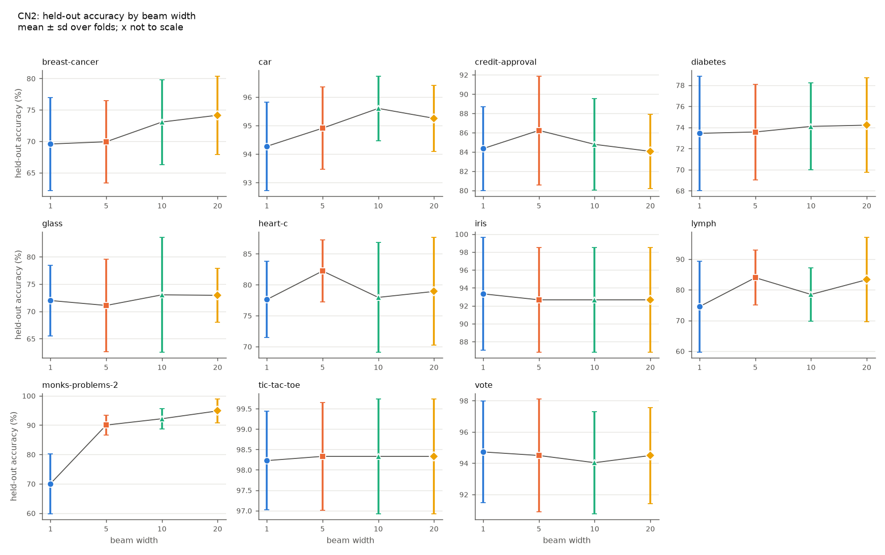
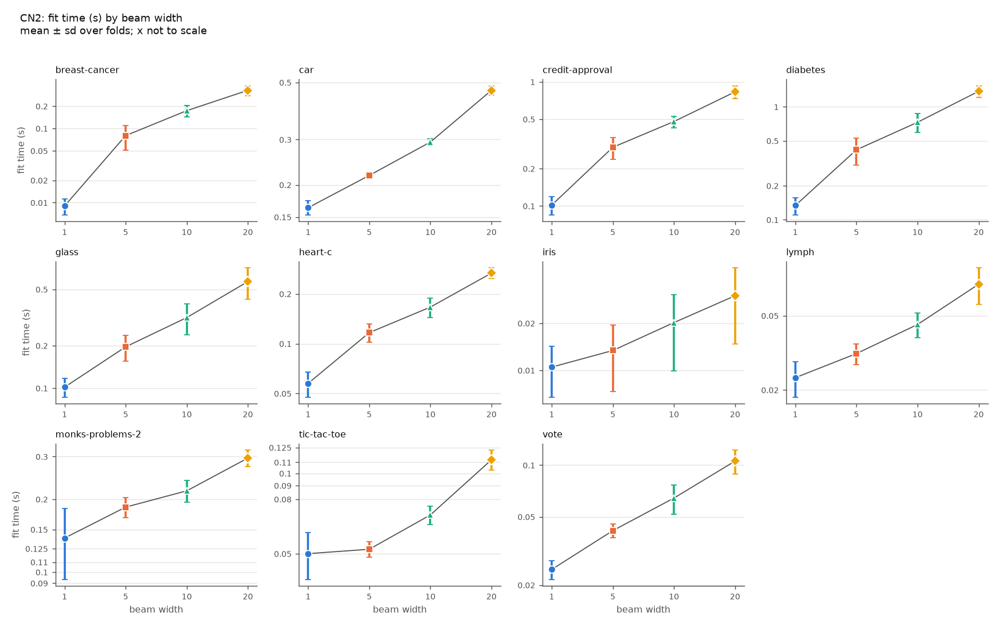
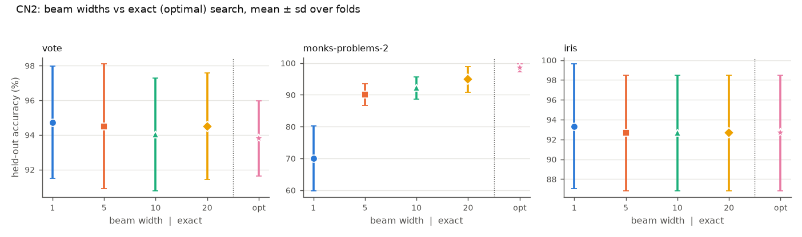
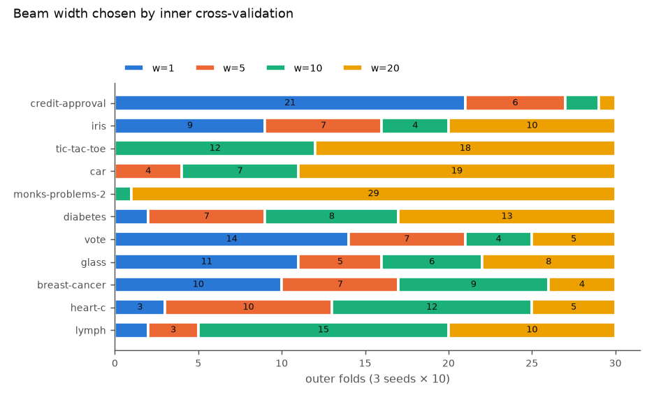

# Does a wider beam make CN2 better?

[](https://www.python.org/)
[](https://github.com/FAW-JKU/pyrulearn)
[](LICENSE)

A small, reproducible study of one hyperparameter of the classic **CN2** rule
learner: its **beam width**, i.e. how many partial rules the search keeps at
each step (`w=1` is greedy search). It uses
[pyrulearn](https://github.com/FAW-JKU/pyrulearn)'s CN2 and its
cross-validation runner, without changing any library code. Every claim was
checked against a decision rule written down *before* the data it applies to
was seen.

**Short answer: not in general.** A wider beam helps a lot on data where
greedy search gets stuck in a local optimum, and does almost nothing on most
datasets. Neither a cheap predictor nor inner cross-validation could reliably
tell in advance which kind of dataset you have.



> The full write-up is in **[REPORT.md](REPORT.md)**. The detailed analysis
> is in [experiment/results/FINAL_ANALYSIS.md](experiment/results/FINAL_ANALYSIS.md).

## Contents

- [Key findings](#key-findings)
- [Study design](#study-design)
- [Results](#results)
  - [1. Fixed widths 1, 5, 10, 20](#1-fixed-widths-1-5-10-20)
  - [2. Exact search as a reference](#2-exact-search-as-a-reference)
  - [3. Can we predict when a wider beam helps?](#3-can-we-predict-when-a-wider-beam-helps)
  - [4. Can the training data choose the width? (nested CV)](#4-can-the-training-data-choose-the-width-nested-cv)
- [Repository layout](#repository-layout)
- [Reproduce](#reproduce)
- [Limitations](#limitations)
- [Open questions](#open-questions)
- [Citation and license](#citation-and-license)

## Key findings

| # | question | answer |
|--:|---|---|
| 1 | Are wider beams more accurate across 11 datasets? | **Not established.** w=20 ranked best on all 3 fold splits, but Friedman p = 0.10 / 0.30 / 0.56 and the median gain was under 1 pp. |
| 2 | Where does width matter? | On **monks-problems-2: +25.5 pp** (70.5% → 96.1%), a concept that greedy search can't see one condition at a time. Lymph gained +6.6 pp. Nine of eleven datasets moved by less than ±1.5 pp. |
| 3 | Is the best possible search best? | **Not always.** Exact (branch-and-bound) search reaches 98.5–99.2% on monks-2, but is 0.9 pp *worse* than greedy on vote. That is consistent with *oversearching*. |
| 4 | Can a training-data score predict the gain? | **No.** Two pre-registered scores reached Spearman ρ = +0.23 / +0.28 and +0.36, below the ρ ≥ 0.5 pass mark. |
| 5 | Can inner cross-validation pick the width? | **Partly.** It finds w=20 on monks-2 (29 of 30 folds), but adds noise where the widths are close. It is not better than the default w=5, and it costs about 24× the fit time. |
| — | Cost | w=20 was the slowest width on every dataset, typically 2–10× w=1. |

One methodological lesson: on the first fold split alone, breast-cancer
gained +4.6 pp from a wider beam. Over three splits it gained +0.7 pp. A
single cross-validation run would have reported a finding that does not hold
up.

## Study design

- **Learner.** pyrulearn's `CN2(beam_width=w)` for w ∈ {1, 5, 10, 20}. All
  other settings are the library defaults: Laplace heuristic,
  likelihood-ratio significance test at p < 0.05, and unordered one-vs-rest
  rule sets.
- **Data.** 11 OpenML datasets from pyrulearn's catalog, 7 binary and 4
  multiclass: vote, breast-cancer, tic-tac-toe, monks-problems-2, heart-c,
  credit-approval, diabetes, iris, lymph, glass, car.
- **Evaluation.** pyrulearn's `run_cv` with 10-fold stratified
  cross-validation. All widths run on identical folds. Numeric attributes
  are discretized on the training fold only. The whole run is repeated with
  three fold splits (seeds 0, 1, 2), for 1,320 fits with no failures.
- **Metrics.** Held-out accuracy (primary), number of rules, number of
  conditions, and fit time.
- **Rules fixed in advance:**
  - [`DECISION_RULE.md`](experiment/DECISION_RULE.md): "wider is better"
    needs Friedman p < 0.05 **and** a median gain of at least 1 pp, on
    *every* seed. Seeds 1–2 were the blind test.
  - [`DEV_LOG.md`](experiment/results/predict/DEV_LOG.md): the prediction
    study, capped at two attempts, with 34 test datasets held out.
  - [`TUNING_RULE.md`](experiment/TUNING_RULE.md): the nested-CV study.

## Results

### 1. Fixed widths 1, 5, 10, 20

| seed | Friedman p | best width | median gain over w=1 | passes the rule |
|--:|--:|---|--:|:-:|
| 0 | 0.10 | w=20 | +0.95 pp | no |
| 1 | 0.30 | w=20 | +0.75 pp | no |
| 2 | 0.56 | w=20 | +0.42 pp | no |

Mean accuracy (%) over the three seeds:

| dataset | w=1 | w=5 | w=10 | w=20 |
|---|--:|--:|--:|--:|
| monks-problems-2 | 70.5 | 90.0 | 92.9 | **96.1** |
| lymph | 77.3 | 82.1 | 80.3 | **83.9** |
| heart-c | 77.4 | **81.1** | 78.7 | 78.5 |
| car | 94.3 | 94.8 | **95.3** | **95.3** |
| diabetes | 74.2 | 74.8 | **75.4** | 74.8 |
| breast-cancer | 72.4 | 71.3 | 72.3 | **73.1** |
| glass | 71.1 | 70.9 | 71.1 | **71.8** |
| iris | 92.7 | 92.7 | 92.9 | **93.3** |
| tic-tac-toe | 97.9 | 98.2 | 98.3 | **98.4** |
| vote | **94.9** | **94.9** | 94.2 | 94.3 |
| credit-approval | **85.0** | 84.7 | 83.8 | 83.5 |

<p align="center">
  
  
</p>

Model size moved in both directions: wider beams gave smaller models on 7
datasets and larger ones on 4. The plots for every seed, including rules and
conditions, are in `experiment/results/<seed>/plots/`.

### 2. Exact search as a reference

`BranchAndBoundSearch` finds the best rule at every step ("w=∞"). It only
finished on 3 of the 11 datasets.

- **monks-problems-2:** 98.5–99.2%, better than w=1 on all 30 folds.
- **vote:** 0.9 pp below greedy (worse on 15 of 30 folds, better on 6), with
  fewer but longer rules. The score being maximized is training fit, not
  test accuracy.
- **iris:** no clear difference.



### 3. Can we predict when a wider beam helps?

| attempt | score, computed from training data only | Spearman ρ with the real gain | result |
|---|---|--:|---|
| 1 | how much greedy loses to exact search within 2–3 conditions | +0.23 / +0.28 | failed |
| 2 | how much better the w=20 first rule is than the w=1 first rule, measured on held-out training rows | +0.36 | failed |

The pass mark was ρ ≥ 0.5. Both attempts failed, so the 34 held-out test
datasets were deliberately left unused. The key observation from attempt 2:
the wider beam found a better *first rule* on all 11 datasets, but the
*whole model* improved on only a few. Full log:
[`DEV_LOG.md`](experiment/results/predict/DEV_LOG.md).

### 4. Can the training data choose the width? (nested CV)

`TunedCN2` ([`tuned.py`](experiment/tuned.py)) picks the width inside each
training fold by 5-fold inner cross-validation, then refits. The outer test
fold is never seen.

| question | criterion | result |
|---|---|---|
| better than the default w=5? | Wilcoxon p < 0.05 and median gain ≥ 1 pp, on every seed | **no**: median gain −0.39 / +0.91 / 0.00 pp |
| as good as the best fixed width in hindsight? | within 1 pp on ≥ 9 of 11 datasets | **no**: 7 of 11 |



Where the gap between widths is large, inner CV finds the right width:
w=20 on monks-2, w=1 on credit-approval. Where the gap is small, it mostly
picks noise, which cost up to 3.4 pp on lymph and heart-c. Details:
[`nested.md`](experiment/results/nested/nested.md).

## Repository layout

```
REPORT.md                    the write-up
experiment/
  run_experiment.py          main experiment: widths × datasets × folds, summary tables and plots
  labeled.py                 CN2 subclasses that only rename themselves ("CN2 (w=…)", "CN2 (optimal)")
  optimal_reference.py       exact-search CN2 on vote, iris, monks-problems-2
  decide.py                  applies DECISION_RULE.md, writes results/decision.md
  report_figure.py           the headline figure
  greedy_regret.py           prediction attempt 1
  validated_gain.py          prediction attempt 2
  tuned.py, nested.py        nested CV: the width is chosen by inner CV
  DECISION_RULE.md           pre-registered rules
  TUNING_RULE.md
  results/
    FINAL_ANALYSIS.md        detailed findings for seeds 0–2
    decision.md              verdict and per-dataset means
    phase1/                  first run: vote only
    phase2/  seed1/  seed2/  11 datasets, fold seeds 0 / 1 / 2:
                             results.csv (one row per fit), summary.md, plots/, optimal/
    predict/                 prediction study: DEV_LOG.md and CSVs
    nested/                  nested-CV results and figures
    *.log                    console output of the runs
```

## Reproduce

```bash
git clone https://github.com/emilzmmn04/cn2-beam-width.git
cd cn2-beam-width
python3.12 -m venv .venv && source .venv/bin/activate   # or: uv venv --python 3.12 .venv
pip install -r requirements.txt                          # installs pyrulearn @ 873e4ed from GitHub

cd experiment
python run_experiment.py                                   # phase 1: vote, 10-fold, seed 0
python run_experiment.py --datasets vote,breast-cancer,tic-tac-toe,monks-problems-2,heart-c,credit-approval,diabetes,iris,lymph,glass,car --tag phase2
python run_experiment.py --datasets <same 11> --seed 1 --tag seed1
python run_experiment.py --datasets <same 11> --seed 2 --tag seed2
python optimal_reference.py --tag phase2 --seed 0          # likewise for seed1/1 and seed2/2
python decide.py phase2:0 seed1:1 seed2:2                  # apply the decision rule
python nested.py                                           # nested CV (the slowest step)
python run_experiment.py --inspect vote --fold 0           # print each width's rule set on one fold
```

- Datasets are downloaded from OpenML on first use, into
  `~/scikit_learn_data`.
- Each finished fit is cached in `experiment/_cache/`, so a rerun only
  recomputes what is missing.
- Options: `--widths 1,5,10,20`, `--folds 10`, `--seed 0`, `--timeout 600`,
  `--n-jobs 1`. More jobs is faster but makes fit times noisier.

**Why `pandas<3`?** With pandas 3.1 and scikit-learn 1.9.1, `fetch_openml`'s
ARFF parser crashes on nominal values that look like numbers. One example is
the values `1`/`2`/`3` in monks-problems-2, which fail with `TypeError:
expected string or bytes-like object, got 'int'`. With pandas 2.3.3 the data
loads correctly, and pyrulearn's seco, runner and catalog tests pass (137
passed, 5 skipped).

## Limitations

- **Few datasets.** 11 hand-picked datasets give the Friedman test little
  power, so "not established" does not mean "no effect". Two of them
  (monks-2, tic-tac-toe) were chosen because greedy search was expected to
  struggle.
- **The decision rule came after seed 0.** It was written after seed 0 was
  seen, so only seeds 1 and 2 are a blind test.
- **Folds are not independent.** They share about 89% of their training
  data, so the sd across folds describes the spread; no per-dataset
  significance tests are done on it.
- **Exact search covers only easy data.** It finished on just 3 datasets.
- **Fit times.** They are wall-clock times from one machine and include
  process overhead, so ratios between widths mean more than absolute
  seconds.
- **Discretization in the nested CV.** Cut-points were set once per outer
  training fold, so the inner validation rows helped choose them.

## Open questions

1. **Oversearching.** Where does more search start to overfit? One way to
   find out is to compare train and test accuracy across widths and exact
   search, on more datasets.
2. **Interaction with the significance threshold.** Does a wider beam help
   more when the likelihood-ratio filter is looser or stricter?
3. **A larger benchmark.** Do the conclusions hold on the 34 held-out
   datasets that the prediction study never used?

## Citation and license

Citation metadata is in [`CITATION.cff`](CITATION.cff). Please also cite
[pyrulearn](https://github.com/FAW-JKU/pyrulearn), which provides the
learners, the search procedures and the evaluation runner.

The code is licensed under the [GNU GPL v3](LICENSE), the same license as
pyrulearn, on which it builds.
