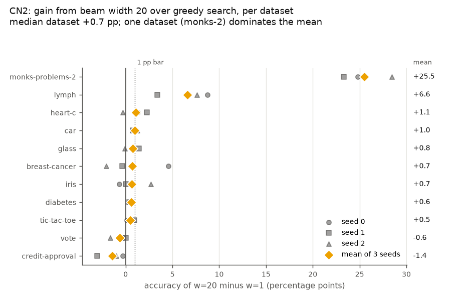
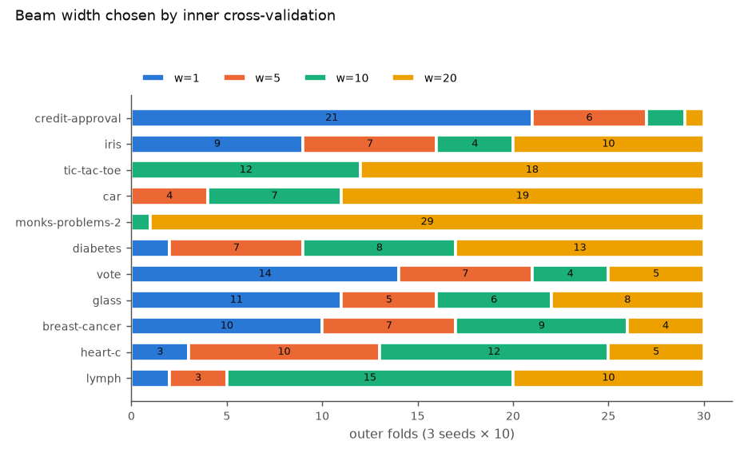

# Does a wider beam make CN2 better? Not in general.

*Emil Zimmermann · 2026-11-12 · pyrulearn `main` @ 873e4ed*

## Question

CN2 learns each rule with a beam search: it keeps the `w` best partial rules
at every step. Greedy search (`w=1`) can get stuck in a local optimum; a wider
beam explores more. Does that make the learned rule sets more accurate, and
what does it cost in model size and fit time?

## Method

- Learner: pyrulearn's `CN2(beam_width=w)` for w = 1, 5, 10, 20; everything
  else at the library defaults (Laplace heuristic, likelihood-ratio
  significance test at p < 0.05, unordered rule sets). No library code changed.
- Data: 11 OpenML datasets from pyrulearn's catalog, 7 binary and 4
  multiclass: vote, breast-cancer, tic-tac-toe, monks-problems-2, heart-c,
  credit-approval, diabetes, iris, lymph, glass, car.
- Evaluation: pyrulearn's `run_cv`, 10-fold stratified cross-validation, all
  widths on identical folds, repeated with three fold splits (seeds 0, 1, 2).
  1,320 fits, none failed.
- Reference: exact search (`BranchAndBoundSearch`, the best possible rule in
  every step, "w=∞") on the three datasets where it was affordable: vote,
  iris, monks-problems-2.
- **Decision rule, fixed in advance** (`experiment/DECISION_RULE.md`): wider
  beams count as better only if, on *each* seed, the Friedman test on
  accuracy gives p < 0.05 *and* the best width's median gain over w=1 is at
  least 1 percentage point. (Written after seeing seed 0; seeds 1 and 2 were
  the blind test.)

## Result

| seed | Friedman p | best width | median gain over w=1 | passes |
|--:|--:|---|--:|:-:|
| 0 | 0.10 | 20 | +0.95 pp | no |
| 1 | 0.30 | 20 | +0.75 pp | no |
| 2 | 0.56 | 20 | +0.42 pp | no |

**Wider beams are not established as better.** w=20 ranked best and w=1
worst on every seed, but the differences were not significant and the typical
dataset gained less than one percentage point.

What the figure shows:

1. **Most datasets: almost no effect.** Nine of eleven moved by less than
   ±1.5 pp on average, often in different directions on different seeds.
2. **A few datasets: a large effect.** monks-problems-2 gained +25.5 pp
   (70.5% → 96.1%) and lymph +6.6 pp. monks-2's concept ("exactly two of six
   attributes have their first value") gives no single condition any signal,
   so greedy search can't find a good first step; that is the local-optimum
   trap the beam is meant to escape.
3. **One split can mislead.** On seed 0, breast-cancer gained +4.6 pp; over
   three seeds, +0.7 pp. A single cross-validation run would have reported a
   finding that does not hold up.

Exact search (reference, 3 datasets):

- monks-problems-2: **98.5–99.2%**, better than w=1 on all 30 folds and never
  worse than w=20. More search paid off at every step.
- vote: slightly *worse* than greedy (−0.9 pp; worse on 15 of 30 folds,
  better on 6), with fewer but longer rules. This is consistent with
  overfitting from searching too hard ("oversearching"), but two datasets are
  not enough to show it.
- iris: no clear difference.

Cost: w=20 was the slowest on every dataset (typically 2–10× w=1); exact
search was 30–400× slower than w=20 and did not finish one fold within 90 s
on the other 8 datasets. Model size moved in opposite directions: wider beams
gave smaller models on 7 datasets and larger ones on 4.

## Can we predict when a wider beam helps? (follow-up)

Two scores computed from training data only were tried, each defined in
writing before it was computed, with a cap of two attempts and a fixed
pass mark (Spearman ρ ≥ 0.5 with the gain on the 11 datasets above):

| attempt | score | ρ | result |
|---|---|--:|---|
| 1 | how much greedy search loses against exact search within 2–3 conditions | +0.23 / +0.28 | failed |
| 2 | how much better the w=20 first rule scores than the w=1 first rule on held-out training rows | +0.36 | failed |

Both failed, so the 34 held-out test datasets set aside for the prediction
were deliberately not used. Attempt 1 mistook noise for structure: on small
noisy datasets exact search finds tiny "perfect" rules that are training-set
accidents. Attempt 2 fixed that, and ranked monks-2 highest and vote lowest,
but found the wider beam's first rule better on *every* dataset, while the
whole model improved on only a few. A better first rule does not reliably
make a better rule set. Full log: `experiment/results/predict/DEV_LOG.md`.

## Can the training data choose the width? (nested cross-validation)

`TunedCN2` picks the beam width per training fold by 5-fold inner
cross-validation over w = 1, 5, 10, 20 (ties to the smaller width), then
refits; the outer test fold is never seen. Same 11 datasets, seeds and
outer folds. Rule fixed in advance (`experiment/TUNING_RULE.md`); no fit
failed.

| question | criterion | result |
|---|---|---|
| better than the default w=5? | Wilcoxon p < 0.05 and median gain ≥ 1 pp, every seed | **no**: median gain −0.39 / +0.91 / 0.00 pp, p = 0.25 / 0.10 / 1.00 |
| as good as the best fixed width in hindsight? | within 1 pp on ≥ 9 of 11 datasets | **no**: 7 of 11 |

- **Where the signal is strong, the data chooses well.** monks-problems-2:
  w=20 in 29 of 30 folds, 95.8% vs 96.1% for the best fixed width (w=5 alone
  loses 6.1 pp there). credit-approval: mostly w=1, which was its best.
- **Where the widths are nearly equal, the choice is noise.** On
  breast-cancer, glass, iris and vote all four widths were chosen; the
  inner estimate on ~200–400 rows cannot tell differences of a point apart,
  and picking the luckiest-looking width costs up to 3.4 pp (lymph, heart-c).
- **It costs about 24× the fit time of w=5.**

Two caveats on the hindsight comparison: the "best fixed width" is the
maximum of four noisy averages, so it is itself optimistic (a lucky width
looks best); and "always w=20" landed within 1 pp on 9 of 11, but that
width was itself identified from these same datasets, so it is not a fair
competitor either.

## Conclusion

A wider beam is cheap insurance, not a general improvement. It matters on
data whose structure hides from one-condition-at-a-time search (monks-2) and
does little elsewhere. Even perfect search can hurt slightly (vote), because
the score being maximized is training fit, not test accuracy. Neither a cheap
score nor inner cross-validation could reliably tell in advance which kind
of dataset you have: where the difference between widths is large, inner CV
finds it; where it is small, choosing adds noise and 24× the cost.

## Limitations

11 hand-picked datasets (two chosen because greedy search was expected to
struggle) give the Friedman test little power, so "not established" is not
"no effect". The decision rule was written after seed 0 was seen. Exact
search covers only 3 easy datasets. Fit times include process overhead and
come from one machine. In the nested CV, numeric attributes were discretized
once per outer training fold, so inner validation rows helped set the
cut-points (training data only, but slightly optimistic for every width). Mechanism claims come from reading fold-0 rule sets.

## Reproduce

See [README.md](README.md#reproduce). Full details: `experiment/results/FINAL_ANALYSIS.md`;
numbers: `experiment/results/decision.md` and `experiment/results/<seed>/`.
